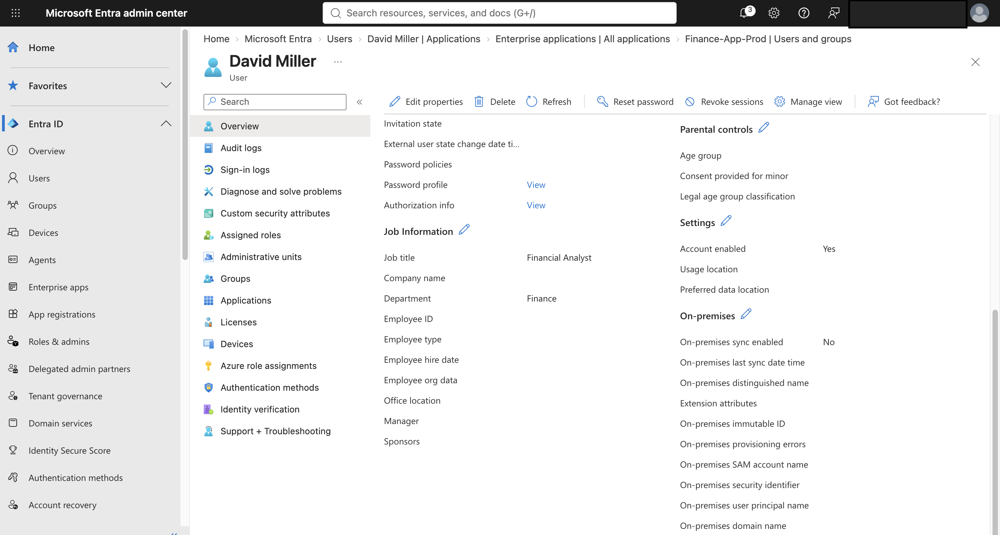
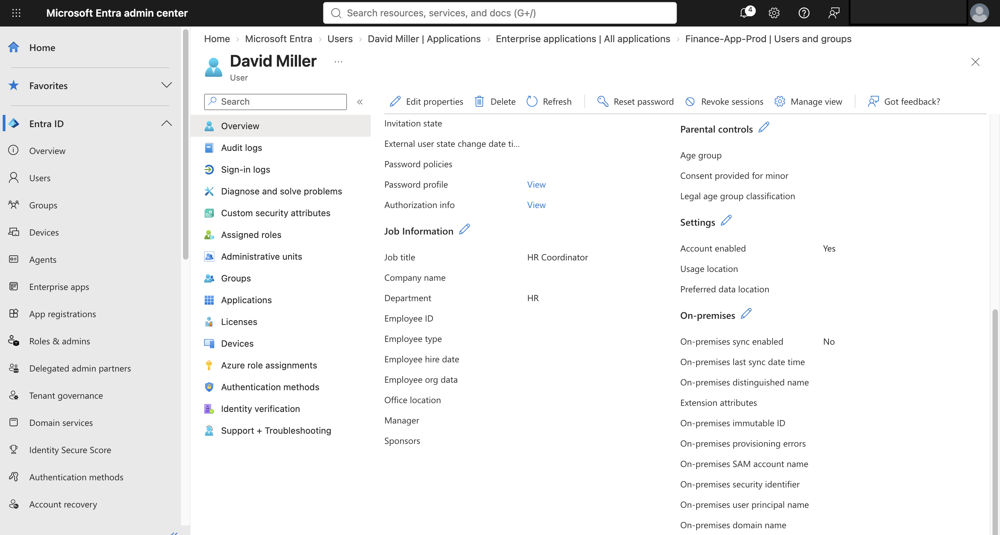
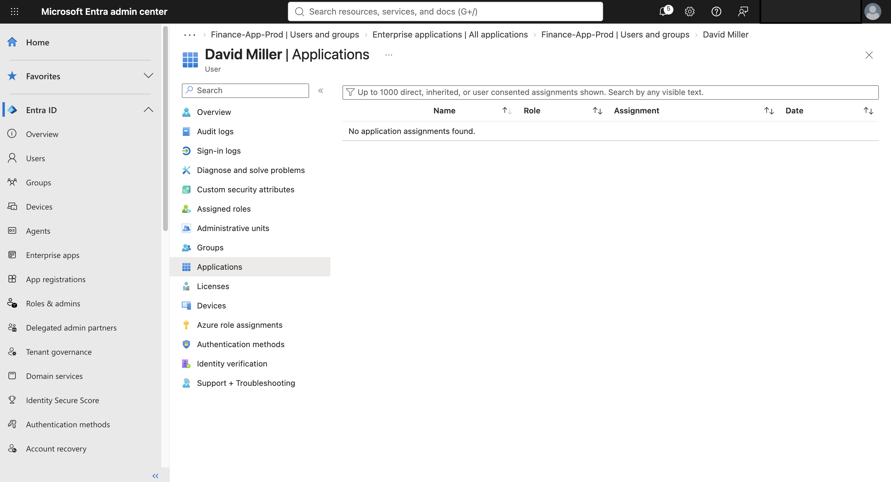
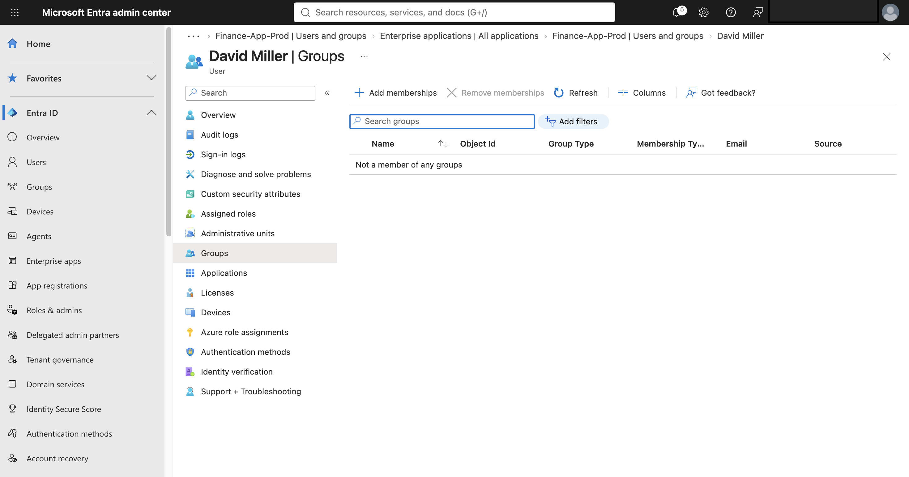
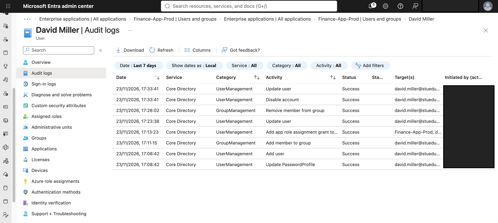

# Microsoft Entra ID: Joiner-Mover-Leaver (JML) & Access Drift Remediation Lab

## Project Overview
This lab simulates an end-to-end **Identity Lifecycle Management (JML)** and **Access Drift Remediation** workflow inside a **Microsoft Entra ID (Free Tier)** tenant. Using a test persona (**David Miller**), this project demonstrates how departmental transfers create **privilege creep (access drift)** when legacy entitlements are not automatically revoked—and how security teams detect, remediate, and audit those permissions using least-privilege controls.

### Key IAM Concepts Demonstrated
* **Joiner (Provisioning):** Role-based onboarding with baseline group (`SG-Finance-Access`) and enterprise application (`Finance-App-Prod`) assignments[cite: 1, 8].
* **Mover (Access Drift Simulation):** Cross-departmental transfer (`Finance` $\rightarrow$ `HR`) exposing lingering legacy entitlements[cite: 3, 4].
* **Access Review & Remediation:** Manual entitlement audit revoking unauthorized group memberships and enterprise app assignments[cite: 5, 6, 8].
* **Leaver (Deprovisioning):** Immediate account disablement and session revocation to prevent orphaned access[cite: 1, 8].
* **Audit & Compliance Verification:** End-to-end traceability via Microsoft Entra ID Directory Audit Logs[cite: 8].

---

## Lab Execution Timeline & Audit Evidence

| Lifecycle Stage | Timestamp (Local) | Identity Action / Event | Entra ID Audit Activity | Status |
| :--- | :--- | :--- | :--- | :--- |
| **1. Joiner** | `23/11/2026, 17:08–17:13` | Provisioned **David Miller** (`Department: Finance`, `Title: Financial Analyst`) and assigned baseline Finance group & `Finance-App-Prod` access[cite: 1, 3, 8]. | `Add user`, `Add member to group`, `Add app role assignment grant to...`[cite: 8] | Success[cite: 8] |
| **2. Mover** | `23/11/2026, 17:23:38` | Transferred user to `Department: HR` (`Title: HR Coordinator`) while leaving Finance entitlements active to simulate **access drift**[cite: 4, 8]. | `Update user`[cite: 8] | Success[cite: 8] |
| **3. Remediation** | `23/11/2026, 17:28–17:30` | Audited user entitlements against HR role; revoked stale Finance group membership and `Finance-App-Prod` assignment[cite: 5, 6, 8]. | `Remove member from group`[cite: 8] | Success[cite: 8] |
| **4. Leaver** | `23/11/2026, 17:33:41` | Disabled user account upon simulated offboarding and verified zero active group/application access[cite: 5, 6, 8]. | `Disable account`, `Update user`[cite: 8] | Success[cite: 8] |

---

## Repository Documentation
* **[01 — JML Lifecycle Runbook](docs/01-jml-lifecycle-runbook.md):** Step-by-step operational SOP covering Joiner provisioning, Mover role updates, and Leaver offboarding/audit checks.
* **[02 — Access Drift & Remediation Analysis](docs/02-access-drift-remediation.md):** Risk analysis of privilege creep (Finance → HR) and manual entitlement cleanup steps, plus Entra ID P1/P2 automation ideas.

---

## Visual Walkthrough & Evidence

### 1. Joiner: Baseline Onboarding (`Finance`)
David Miller was created as a Member user with `Department: Finance` and `Job title: Financial Analyst`, and provisioned baseline access to `Finance-App-Prod`[cite: 1, 3].

### 2. Mover: Role Transition & Access Drift (`Finance` $\rightarrow$ `HR`)
Upon transferring to `Department: HR` (`Job title: HR Coordinator`), David retained his legacy Finance entitlements—demonstrating how unmonitored role changes lead to privilege creep[cite: 4].

### 3. Access Drift Remediation: Entitlement Cleanup
Following a manual access review against his new HR role, all stale Finance application and group assignments were revoked[cite: 5, 6, 8].

| Enterprise Applications Cleaned | Security Groups Cleaned |
| :---: | :---: |
|  |  |

### 4. Leaver & Audit Log Verification
To complete offboarding, David Miller's account was disabled (`Account enabled: No`)[cite: 8]. The Entra ID **Audit logs** blade confirms every lifecycle and remediation event executed with `Status: Success`[cite: 8].

---

## Production Scaling Recommendations (Entra ID P2 / Governance)
While this lab executed manual reviews on Entra ID Free, enterprise environments automate these controls using:
1. **Dynamic Security Groups:** Automatically add/remove users from `SG-Finance-Access` based on the rule `(user.department -eq "Finance")`.
2. **Microsoft Entra ID Governance (Access Reviews):** Schedule recurring quarterly access reviews for sensitive enterprise applications.
3. **Lifecycle Workflows:** Trigger automated Joiner/Mover/Leaver tasks (such as temporary access passes, group removals, and account disablement) based on HR attribute changes.
